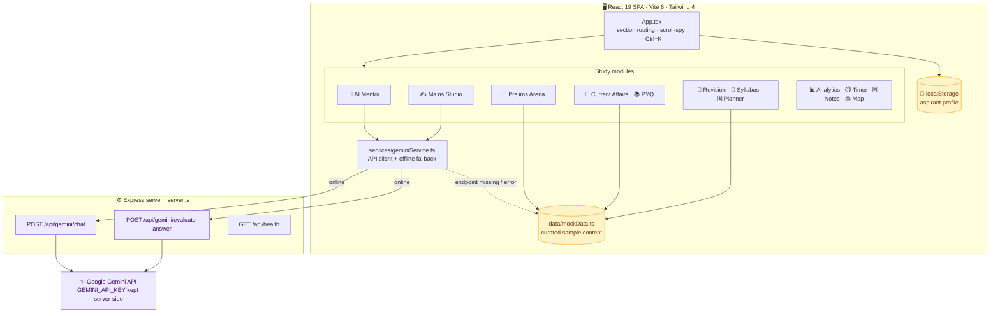
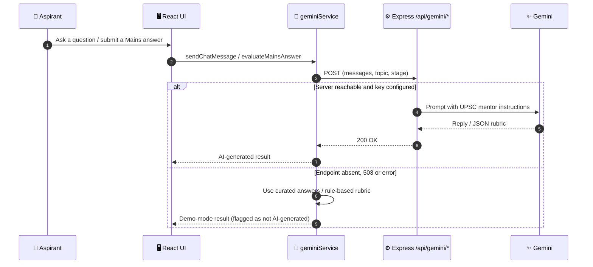

<div align="center">

<br/>

# 🏛️ UPSC ZONE AI

### Intelligent UPSC Civil Services Preparation Platform

**AI mentor · Prelims simulator · Mains answer studio · Current affairs desk · Adaptive planner**

<br/>

<a href="https://upsc-zone-ai-9wf5.vercel.app/">
  
</a>

<br/><br/>


<br/>

**[🌐 Live Demo](https://upsc-zone-ai-9wf5.vercel.app/)** &nbsp;│&nbsp;
**[✨ Features](#-features)** &nbsp;│&nbsp;
**[🏗️ Architecture](#️-architecture)** &nbsp;│&nbsp;
**[🚀 Quick Start](#-quick-start)** &nbsp;│&nbsp;
**[📡 API](#-api-reference)** &nbsp;│&nbsp;
**[🗺️ Roadmap](#️-roadmap)**

<br/>

> One place for the whole Civil Services journey: **learn, practise, write, revise and plan**,
> with an AI mentor that answers like a UPSC coach.

<br/>

</div>

---

<div align="center">

## 📖 Overview

</div>

<div align="center">

**UPSC ZONE AI** is a single-page preparation workspace for UPSC CSE aspirants.
It brings a **Prelims exam simulator**, a **Mains writing studio with AI evaluation**, a **current affairs desk**, **PYQ explorer**, **spaced revision**, a **syllabus navigator** and a **study planner** together, with a Gemini-powered mentor that can answer syllabus questions and score a descriptive answer.

</div>

<br/>

<div align="center">

| 🧠 AI Mentor | 📝 Prelims Arena | ✍️ Mains Studio | 🗓️ Smart Planner |
|:---:|:---:|:---:|:---:|
| Structured, article-cited answers with follow-up questions | Multi-statement MCQs with official-style negative marking | Write, count words, get a rubric score and print | Day-wise plan tuned to your stage and daily hours |

</div>

---

<div align="center">

## ✨ Features

</div>

<div align="center">

| | Module | What it does |
|:---:|:---|:---|
| 🤖 | **AI Mentor** | Chat copilot for UPSC topics; context-aware by subject and exam stage |
| 🎯 | **Prelims Arena** | GS Paper 1 style simulator: +2.00 for correct, −0.66 for wrong, with rationale |
| ✍️ | **Mains Writing Studio** | Answer editor with word limit, AI evaluation (score, missing dimensions, value additions) and print-friendly output |
| 📰 | **Current Affairs Desk** | Curated articles mapped to the syllabus |
| 📚 | **PYQ Explorer** | Browse previous-year questions by subject |
| 🔁 | **Revision Lab** | Flashcards with confidence rating to calibrate the next interval |
| 🧭 | **Syllabus Navigator** | Track coverage across papers and topics |
| 🗓️ | **Study Planner** | Plan generated around stage and daily study hours |
| 📊 | **Analytics Dashboard** | Progress and performance visuals |
| ⏱️ | **Focus Timer** | Distraction-free study sessions |
| 🗒️ | **Notes Studio** | Capture and organise notes |
| 🕸️ | **Knowledge Map** | Linked concept graph across subjects |
| ❓ | **Doubt-to-Practice** | Turn a doubt into practice questions |
| 🎒 | **Resource Library** | Reference books and sources by subject |
| 🏅 | **Daily Missions** | Small daily goals and streak tracking |
| ⌨️ | **Command Menu** | `Ctrl/⌘ + K` to jump to any section |
| 👤 | **Aspirant Profile** | Name, target year, optional subject, stage and study hours, saved in the browser |

</div>

<div align="center">

**Subjects covered:** Polity & Governance · History · Geography & Environment · Economy & Social Development · Science, Technology & Security · Ethics, Integrity & Aptitude · Current Affairs

</div>

---

<div align="center">

## 🏗️ Architecture

</div>



<div align="center">

### 🔁 AI Request Flow (with graceful fallback)

</div>



<div align="center">

**Design notes:** the Gemini key never reaches the browser, and every AI feature has a built-in fallback so the app stays usable without a key.

</div>

---

<div align="center">

## 🧰 Tech Stack

</div>

<div align="center">

| Layer | Technology |
|:---:|:---|
| 🎨 **Frontend** | React 19 · TypeScript · Vite 8 · Tailwind CSS 4 · Motion · Lucide Icons |
| ⚙️ **Server** | Node.js · Express 4 · `tsx` · dotenv |
| ✨ **AI** | Google Gen AI SDK (`@google/genai`), server-side only |
| 💾 **State** | React state + browser `localStorage` for the aspirant profile |
| ☁️ **Hosting** | Vercel (static build, SPA rewrite) |

</div>

---

<div align="center">

## 🚀 Quick Start

**Prerequisites:** Node.js 18+

</div>

```bash
git clone https://github.com/sathi2305/UPSC-ZONE-AI-ADVISOR.git
cd UPSC-ZONE-AI-ADVISOR

npm install
echo "GEMINI_API_KEY=your_key_here" > .env     # optional, enables live AI
npm run dev                                      # → http://localhost:3000
```

<details>
<summary><b>⚙️ Environment variables</b></summary>

| Variable | Default | Purpose |
|:---|:---|:---|
| `GEMINI_API_KEY` | *(empty)* | Enables live Gemini chat and answer evaluation |
| `PORT` | `3000` | Server port |
| `NODE_ENV` | *(unset)* | Set to `production` to serve the built `dist/` |

</details>

<details>
<summary><b>📜 Scripts</b></summary>

| Command | What it does |
|:---|:---|
| `npm run dev` / `npm start` | Express server with Vite middleware |
| `npm run build` | Production build to `dist/` |
| `npm run preview` | Preview the build |
| `npm run lint` | Type-check with `tsc --noEmit` |

</details>

> No key? Everything still works: the mentor and the Mains evaluator switch to their built-in demo engines.

---

<div align="center">

## 📡 API Reference

</div>

<div align="center">

| Method | Endpoint | Body | Returns |
|:---:|:---|:---|:---|
| `GET` | `/api/health` | none | `status`, `hasGeminiKey`, `timestamp` |
| `POST` | `/api/gemini/chat` | `messages[]`, `topic`, `stage` | `reply`, `model` |
| `POST` | `/api/gemini/evaluate-answer` | `question`, `syllabusTopic`, `answer` (30+ chars), `wordLimit` | `score`, `wordCount`, feedback, `missingDimensions`, `valueAdditionSuggestions`, `overallAssessment` |

If no key is set, both Gemini endpoints return `503` with `offlineMode: true`.

</div>

---

<div align="center">

## 📁 Project Structure

</div>

```text
UPSC-ZONE-AI-ADVISOR/
├── server.ts                    # Express: /api/health, /api/gemini/*
├── vercel.json                  # build + SPA rewrite
├── vite.config.ts
├── src/
│   ├── App.tsx                  # layout, scroll-spy, command menu, profile
│   ├── components/              # AIMentor, PrelimsArena, MainsWritingStudio,
│   │                            # CurrentAffairsDesk, PYQExplorer, RevisionLab,
│   │                            # SyllabusNavigator, StudyPlanner, AnalyticsDashboard,
│   │                            # FocusTimer, NotesStudio, KnowledgeMap,
│   │                            # DoubtToPractice, ResourceLibrary, DailyMissions ...
│   ├── services/geminiService.ts    # API client with offline fallback
│   ├── data/mockData.ts         # curated sample content
│   └── types/index.ts
└── package.json
```

---

<div align="center">

## 🌐 Deployment

**Live now:** [**upsc-zone-ai-9wf5.vercel.app**](https://upsc-zone-ai-9wf5.vercel.app/)

</div>

- The Vercel project builds with `npm run build` and serves `dist/` as a **static single-page app**.
- Live AI needs the Express server. To enable it, host `server.ts` (`NODE_ENV=production npm start` with `GEMINI_API_KEY` set), or move the two Gemini routes into Vercel serverless functions.

> **Good to know:** the public Vercel site has no `/api` routes, so it runs in **demo mode**. The mentor answers from the curated knowledge base and the Mains evaluator uses its rubric engine. Results are labelled as not AI-generated.
> The Prelims questions, PYQs, current-affairs articles, flashcards and resources are a **small curated sample** (a handful of items per module), not a full question bank.

---

<div align="center">

## 🗺️ Roadmap

</div>

<div align="center">

| Status | Item |
|:---:|:---|
| ✅ | Full study workspace with 15+ modules and command menu |
| ✅ | Gemini mentor and Mains evaluation with offline fallback |
| 🔜 | Vercel serverless functions so live AI works on the deployed site |
| 🔜 | Larger Prelims and PYQ banks with daily current-affairs updates |
| 🔜 | Cloud accounts so progress syncs across devices |
| 💡 | Mock test series with rank analytics |
| 💡 | Optional-subject modules and answer-writing streak leaderboards |

</div>

---

<div align="center">

## 🤝 Contributing

**Fork** → **Branch** (`feature/your-idea`) → **Commit** → **Push** → **Open a Pull Request**

<br/>

## 📄 License

No license file has been added yet. Add a `LICENSE` file (for example MIT) to define reuse terms.

</div>

---

<div align="center">

## 👨‍💻 Author

**Sathiyamoorthi** · [@sathi2305](https://github.com/sathi2305)

<br/>

> ⚠️ **Disclaimer:** UPSC ZONE AI is an independent study aid and is not affiliated with the UPSC.
> AI answers can contain errors; verify facts against standard sources and official notifications.

<br/>

<a href="https://upsc-zone-ai-9wf5.vercel.app/">
  
</a>

<br/><br/>

**⭐ If this helps your preparation, please star the repo! ⭐**

<sub>Made with ❤️ for Civil Services aspirants</sub>

</div>
